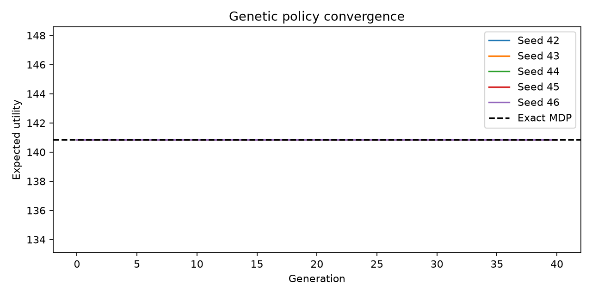
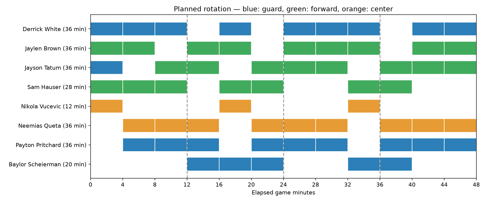

# Genetic algorithm versus MDP substitution planning

Both methods optimize an adaptive policy over the same feasible states, actions, transitions and utility.
The genetic algorithm receives no MDP-optimal actions or values during evolution.

| Policy | Exact expected utility |
| --- | ---: |
| ga | 140.841917 |
| mdp | 140.841917 |
| fixed | 140.829836 |
| greedy | 140.829836 |

Best GA gap to exact MDP: 0.000000. Selected seed: 42.
46 feasible decision states; 3 with multiple actions.
5 independent genetic runs; population 40; 40 generations.
500 paired simulation paths; all schedules passed minute, position and rest checks.

Equality on this small scenario does not demonstrate superiority or better scaling.
The outcome concerns assumed simulation utility, not real-game wins.

See [the comparison guide](../../docs/GENETIC_SUBSTITUTIONS.md) for representation, operators and limitations.
