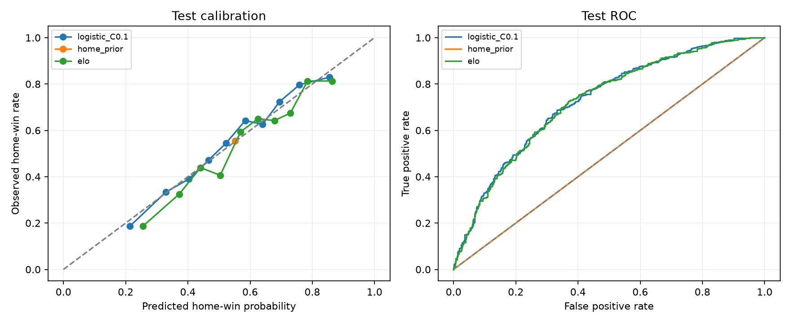
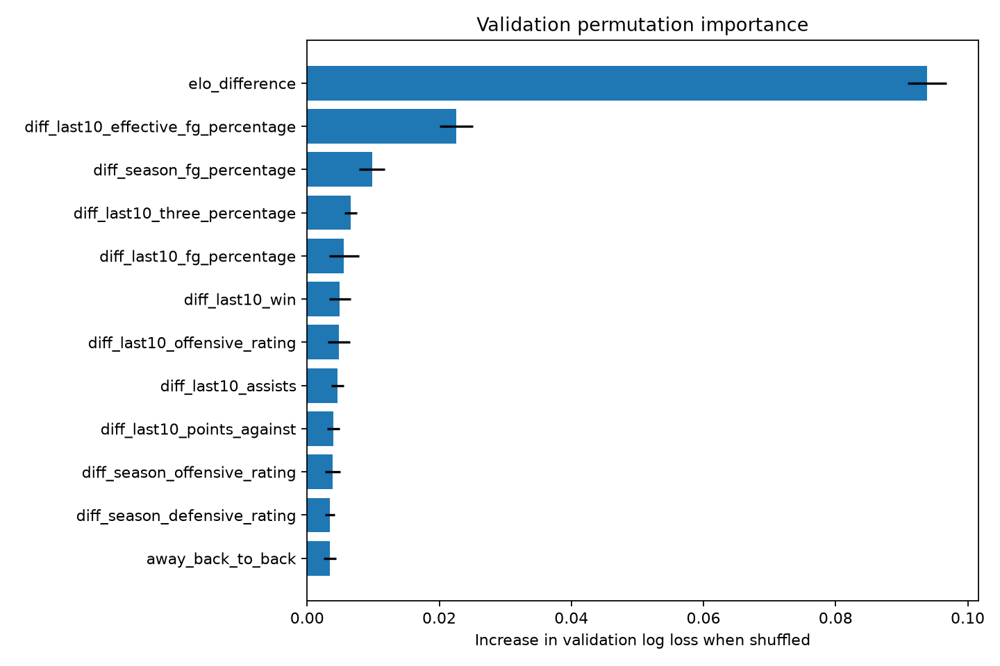

# Pregame result prediction

Selected model: **logistic_C0.1**, chosen by validation log loss.

The target is the probability that the home team wins. A probability of 0.5 is the classification threshold.

## Chronological split

| Split | Games | First date | Last date |
| --- | ---: | --- | --- |
| train | 5829 | 2019-10-22 | 2024-04-14 |
| validation | 1224 | 2024-10-22 | 2025-04-13 |
| test | 1230 | 2025-10-21 | 2026-04-12 |

## Validation model comparison

| Model | Accuracy | Log loss | Brier score | ROC-AUC |
| --- | ---: | ---: | ---: | ---: |
| logistic_C0.1 | 0.677 | 0.603 | 0.209 | 0.730 |
| logistic_C1 | 0.674 | 0.604 | 0.209 | 0.729 |
| logistic_C10 | 0.673 | 0.604 | 0.209 | 0.729 |
| gradient_boosting_l2_10 | 0.663 | 0.612 | 0.212 | 0.720 |
| random_forest | 0.660 | 0.614 | 0.213 | 0.718 |
| gradient_boosting_l2_1 | 0.655 | 0.618 | 0.215 | 0.712 |
| elo | 0.652 | 0.618 | 0.215 | 0.713 |
| home_prior | 0.544 | 0.689 | 0.248 | 0.500 |

## Held-out test

| Model | Accuracy | Log loss | Brier score | ROC-AUC |
| --- | ---: | ---: | ---: | ---: |
| logistic_C0.1 | 0.672 | 0.603 | 0.208 | 0.729 |
| elo | 0.678 | 0.608 | 0.210 | 0.726 |
| home_prior | 0.554 | 0.687 | 0.247 | 0.500 |

## Evaluation rules

- Use only games from earlier calendar days to build features. Exclude all same-day results.
- Reset rolling and cumulative statistics each season. Carry Elo across seasons with 25% regression to 1500.
- Fit imputation and scaling on training data inside each model pipeline.
- Select the learned model using validation only, then refit it on training plus validation.
- Freeze model weights for testing. Update histories with earlier test-day results, as in daily forecasting.
- Evaluate the selected model and fixed baselines on the test set. Do not use test scores to select a new model.
- Estimate feature importance on validation before the final refit.

## Limits

- This is a retrospective daily forecast, not a live betting or deployment system.
- Missing source games shorten histories. Source snapshots may include later corrections.
- The dataset does not identify neutral venues reliably. Home advantage is approximate, including the 2019–20 bubble.
- Injuries are excluded because publication and game timezones have not been verified.
- Possessions use a box-score approximation. Player transfers and expected lineups are not modeled directly.
- Point estimates describe one held-out season. They do not establish performance in future seasons.
- Correlated statistics can share permutation importance; these values do not establish causation.

## Figures

