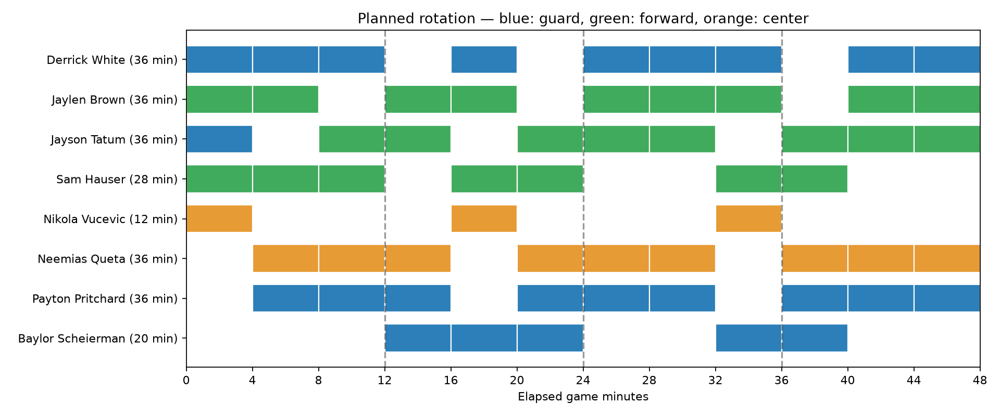

# Starting five and minute plan

Team: 1610612738. Scenario date: 2026-04-01.
Solver status: **OPTIMAL**. Utility: 148.655; upper bound: 148.655.

This retrospective example assumes candidate availability. Confirm the roster before using the plan.
The utility is a planning preference, not a forecast of points, wins or the causal effect of extra minutes.

| Player | Starts | Minutes |
| --- | --- | ---: |
| Derrick White | Yes | 36 |
| Jaylen Brown | Yes | 36 |
| Jayson Tatum | Yes | 36 |
| Sam Hauser | Yes | 28 |
| Nikola Vucevic | Yes | 12 |
| Neemias Queta | No | 36 |
| Payton Pritchard | No | 36 |
| Baylor Scheierman | No | 20 |
| Amari Williams | No | 0 |
| Charles Bassey | No | 0 |
| Hugo Gonzalez | No | 0 |
| John Tonje | No | 0 |
| Jordan Walsh | No | 0 |
| Luka Garza | No | 0 |
| Max Shulga | No | 0 |
| Ron Harper Jr. | No | 0 |

Total: 240 player-minutes. Every block covers two guard, two forward and one center slot.
The exported schedule passed independent constraint checks.

See [the planning guide](../../docs/ROTATION_PLANNING.md) for assumptions and configuration.
