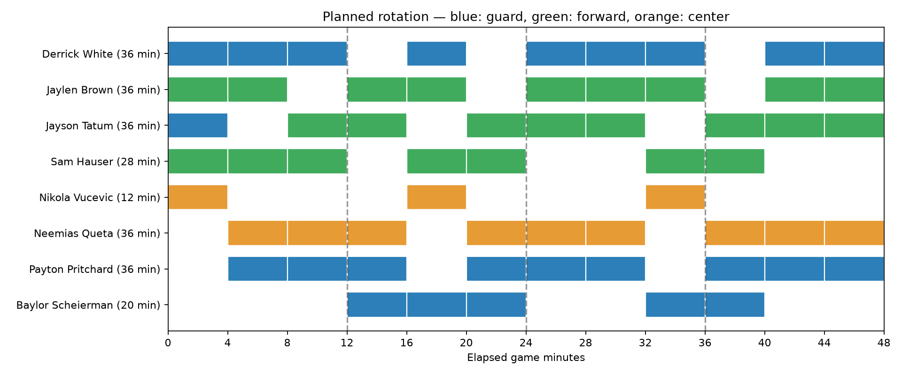

# Substitution policy results

The finite-horizon Markov decision process reorders quarter blocks while preserving the Element 4 minute budgets.
Contexts, fatigue effects and substitution costs are simulation assumptions, not estimated causal basketball effects.

| Policy | Exact expected utility |
| --- | ---: |
| mdp | 131.7744 |
| fixed | 131.7744 |
| greedy | 131.7744 |

Evaluated 500 paired simulated context paths. Exported 46 decision states.
All exported and simulated rotations passed the Element 4 checks and exact per-quarter minute checks.
The optimality statement applies only to this finite action set, transition model and utility.

The chart shows the first seeded simulation, not an expected or observed real-game rotation.

See [the method guide](../../docs/SUBSTITUTION_PLANNING.md) for the state, Bellman equation and limitations.

A [genetic algorithm comparison](../genetic_substitutions/RESULTS.md) evaluates the same decision problem.
